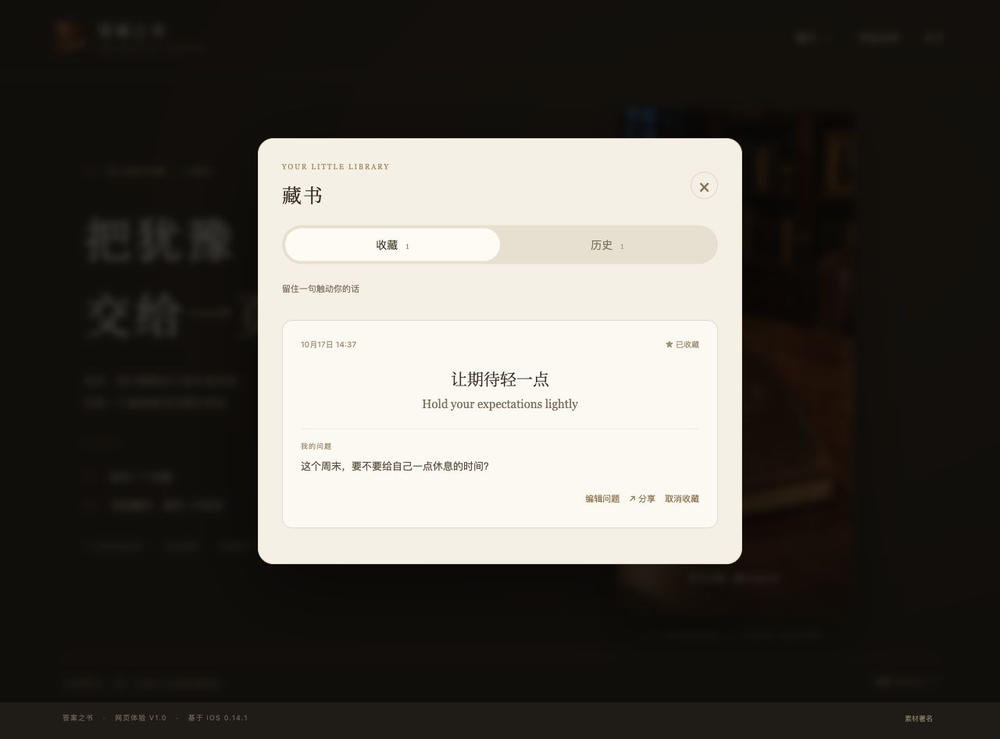
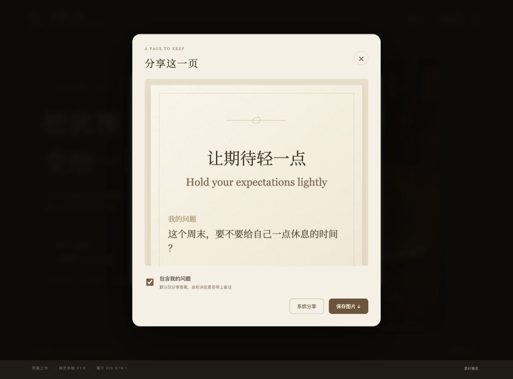
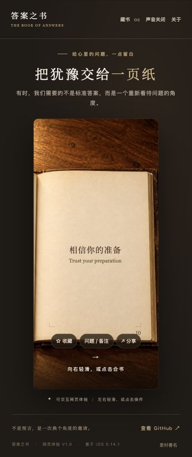

# 答案之书 · The Book of Answers

作品资料版本：V1.0｜状态：网页已完成，公开访问待确认｜日期：2026年10月17日。

## 解决什么问题／能做什么

为日常小事犹豫时，默念问题，轻轻翻开书，获得一句中英双语启发。真实翻书动画与纸页声音带来安静的阅读体验；可以收藏答案、记录当时的问题，并生成纸质卡片保存或分享。

包含iOS原生应用与可交互网页体验。网页无需登录，收藏、历史和备注保存在当前浏览器；iOS暂未上架，与网页数据不互通。

## 体验链接和GitHub链接

- 网页体验：https://answers-book-ethan.yguodong627.chatgpt.site （当前站主私有预览，公开访问待确认）
- GitHub：https://github.com/yguodong627-star/answers-book （公开源码展示）

## 截图

以下均为网页实际运行截图，使用演示记录；当前动画清晰度仍待高清素材替换。

### 网页封面

### 双语答案

### 藏书与备注

### 分享预览

### 手机宽度体验

附图目录另含网页实际导出的PNG卡片，可直接查看保存效果。桌面截图1280×900，手机断点检查390×844；手机宽度截图不代表原生App真机验证。
